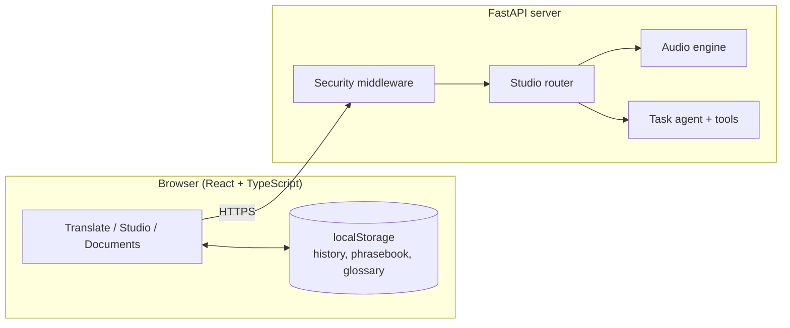

# VOTEX
 
Multilingual translation, text-to-speech and voice tools for Indian languages, in one web app.
 
[Live demo](https://votex-iljx.onrender.com/) · [API docs](https://votex-iljx.onrender.com/docs) · [Report an issue](../../issues)
 


 
<!-- Add a screenshot or short GIF of the app here:

-->
 
---
 
## About
 
Most translation tools handle text and stop there. VOTEX puts text translation, spoken output, voice recording and document translation behind a single interface, with first-class support for Indian scripts and languages.
 
It supports 70+ languages for translation, including the major scheduled Indian languages such as Hindi, Kannada, Tamil, Telugu, Marathi, Bengali, Gujarati, Punjabi, Malayalam, Urdu, Odia, Assamese and Nepali. No paid cloud API key is required to run it.
 
## Features
 
**Text translation**
- Automatic source-language detection across 70+ languages
- Native-script rendering for Devanagari, Kannada, Gujarati, Tamil, Telugu, Gurmukhi, Bengali, Malayalam and Nastaliq
- Formal and casual tone options
- Custom glossary so specific terms are always translated the way you want
**Text-to-speech**
- Streaming MP3 output through a single endpoint
- Hindi, Kannada, Gujarati, Tamil, Telugu, Marathi, Bengali, Punjabi, Malayalam, Urdu, Nepali, Assamese and English
- In-browser playback and one-click download
**Voice studio**
- Record from the microphone with a live amplitude meter
- Noise reduction using FFT-based spectral gating, aimed at steady background noise such as fans and room hum
- Speech-to-translation workflow for cross-language voice input
**Document translation**
- Upload `.txt`, `.pdf`, `.docx` and similar files
- Guide the output with plain-language instructions, for example: *"Translate into formal Kannada and keep clause numbering and section headings."*
- Download the translated file
**Privacy**
- Translation history, saved phrases and glossary live in the browser's `localStorage`
- Nothing user-specific is stored on the server
## How it works
 

 
In production, the same FastAPI process serves both the API and the built React app, so the whole project deploys as one container.
 
### API overview
 
| Method | Endpoint | Purpose |
|--------|----------|---------|
| `POST` | `/api/v1/studio/translate` | Translate text |
| `GET`  | `/api/v1/studio/tts?text=...&lang=...` | Stream synthesized speech as MP3 |
| `POST` | `/api/v1/studio/denoise` | Apply noise reduction to an audio file |
| `GET`  | `/health` | Liveness and readiness check |
 
Full request and response schemas are in the interactive docs at [`/docs`](https://votex-iljx.onrender.com/docs).
 
## Getting started
 
### Requirements
 
- Python 3.11 or newer
- Node.js 18 or newer (20 recommended)
- Git
### 1. Clone
 
```bash
git clone https://github.com/Rahulbharvadiya/VOTEX.git
cd VOTEX
```
 
### 2. Run the backend
 
Linux / macOS:
 
```bash
export PYTHONPATH=src
pip install -r requirements.txt
python -m uvicorn votex_api.main:app --host 127.0.0.1 --port 8000 --reload
```
 
Windows (PowerShell):
 
```powershell
$env:PYTHONPATH="src"
python -m pip install -r requirements.txt
python -m uvicorn votex_api.main:app --host 127.0.0.1 --port 8000 --reload
```
 
The API is now available at `http://127.0.0.1:8000`.
 
### 3. Run the frontend
 
In a second terminal:
 
```bash
cd frontend
npm install
npm run dev
```
 
Open `http://localhost:5173`.
 
## Deployment
 
The repository includes a [`render.yaml`](./render.yaml) blueprint for Render.
 
1. Push or fork the repository to your GitHub account.
2. In the Render dashboard, choose **New → Blueprint** and select the repository.
3. Render runs `build.sh` (builds the frontend, installs Python dependencies) and starts the server:
```bash
uvicorn votex_api.main:app --host 0.0.0.0 --port $PORT
```
 
No external database or object storage is needed.
 
## Project structure
 
```text
VOTEX/
├── src/
│   ├── bodhan_agent/        # Task execution loop and planner
│   ├── bodhan_core/         # Language definitions, normalization, cost tracking
│   ├── bodhan_mcp/          # Agent tools: transcribe, translate, denoise, synthesize
│   └── votex_api/
│       ├── main.py          # App entry point and SPA mount
│       ├── routers/         # Studio and TTS routes
│       ├── services/        # Translation and audio engine
│       └── middleware/      # Security headers, CSP, request size limits
├── frontend/
│   ├── src/
│   │   ├── App.tsx          # Main interface
│   │   └── lib/api.ts       # Typed API client
│   ├── index.html
│   └── vite.config.ts
├── tests/                   # Unit and integration tests
├── build.sh                 # Production build script
├── render.yaml              # Render deployment blueprint
└── requirements.txt
```
 
## Tests
 
```bash
export PYTHONPATH=src
python -m pytest tests/
```
 
## Security
 
- Security headers on every response: `X-Content-Type-Options`, `X-Frame-Options`, `Referrer-Policy` and a restrictive `Permissions-Policy`
- Content Security Policy that allows only the required third-party sources (`flagcdn.com`, Google Fonts)
- Uploads are validated by file signature and limited in size
- User data stays on the client; the server does not persist translation history
## Roadmap
 
- [ ] Batch translation for multiple documents
- [ ] Exportable glossaries (CSV / JSON)
- [ ] Additional TTS voices per language
- [ ] Offline-capable PWA mode
*Edit this list to match what you actually plan to build.*
 
## Contributing
 
Issues and pull requests are welcome. For larger changes, please open an issue first to discuss what you would like to change.
 
1. Fork the repository
2. Create a branch: `git checkout -b feature/your-feature`
3. Commit your changes and push the branch
4. Open a pull request
## License
 
Released under the [MIT License](LICENSE).
 
